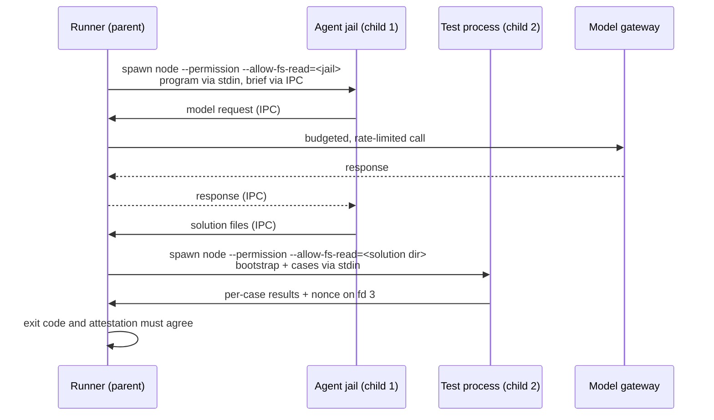
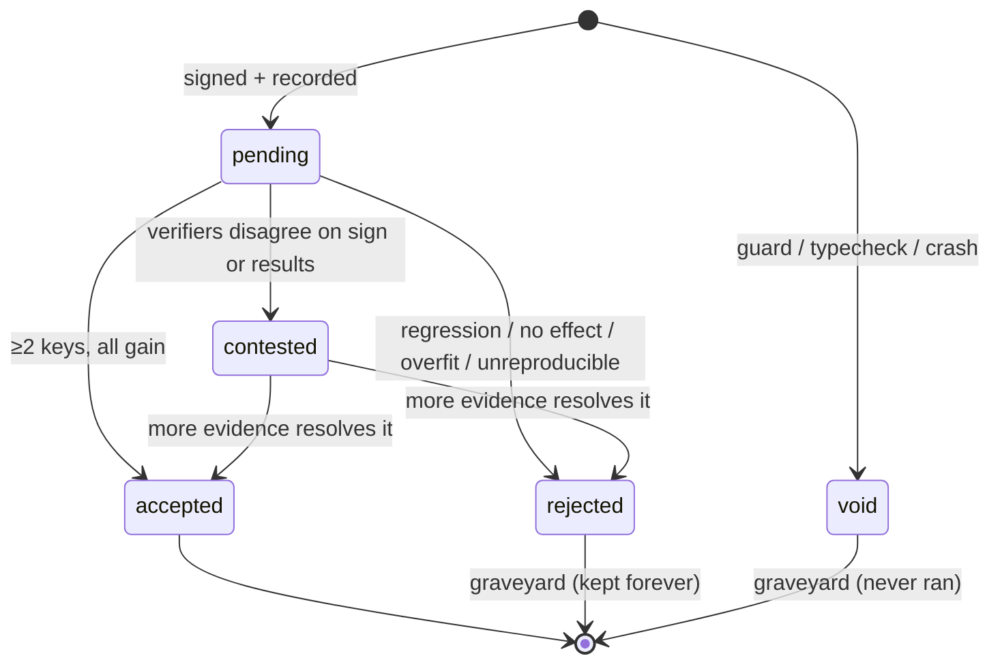
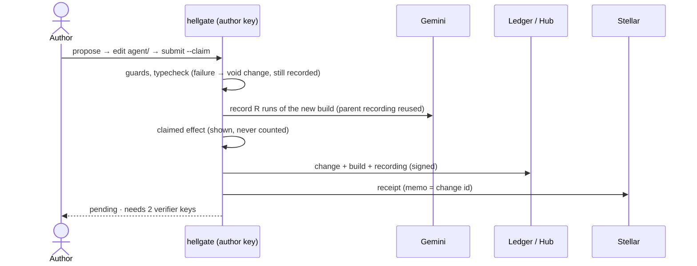
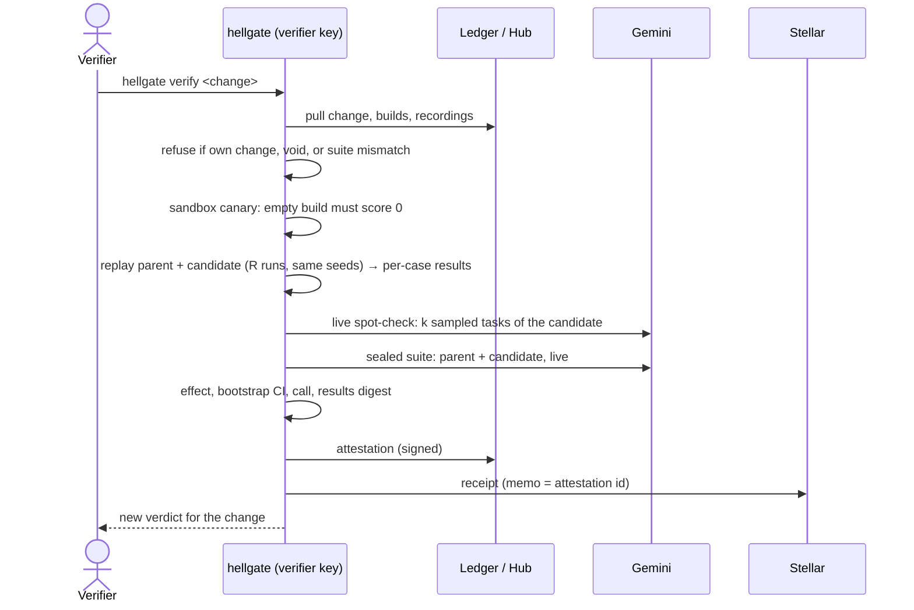

# Hellgate architecture

> Every change to an AI agent must pass the gate. Changes that fail go to the graveyard,
> with the numbers that killed them, so nobody makes them again.

This document describes how Hellgate is built and why. The exact bytes, records and
formulas live in [PROTOCOL.md](PROTOCOL.md).

---

## 1. The problem

People change the prompt or the control loop of an LLM agent, try a few examples, decide
it "feels better", and ship it. That causes three problems:

1. **No measurement.** There is no baseline, no repeat count and no idea of noise. A
   one-run "+8%" is often nothing.
2. **No trust.** Even when the author runs an eval, the reader has to take the
   author's word for it. Nobody else re-ran it.
3. **No memory.** Failed ideas live in one person's terminal history. The next person
   tries them again and pays for the same tokens.

Evaluation tools exist. What does not exist is a way to make an eval result
**believable to someone who was not in the room**. That is the gap Hellgate fills.

## 2. The idea in one paragraph

A **change** to an agent is a small code edit plus a written **claim** ("this will
raise the score by at least 3 points, and it is false if…"). The author records a live
run of the new agent. Then at least two **verifiers**, holding keys other than the
author's, re-measure the parent and the change side by side on the same seeds. Each
verifier signs an **attestation** with a confidence interval. A pure function turns the
signed evidence into a **verdict**. Accepted changes pass **through the gate** and
become the new baseline. Everything else goes to the **graveyard** with its epitaph:
the claim, the measured effect and the reason it died. Nothing is ever deleted. Each
signature also gets a public, timestamped **receipt** on the Stellar network.

## 3. Design principles

| # | Principle | What it means in the code |
|---|---|---|
| P1 | The author never judges their own change | Author attestations are ignored. Acceptance needs ≥ 2 distinct verifier keys. |
| P2 | Measure against noise, not against zero | A paired comparison with a bootstrap confidence interval. A gain must clear both the interval and a minimum effect. |
| P3 | Deterministic scoring | Unit tests decide pass or fail. No LLM judges another LLM. |
| P4 | Failure is data | Rejected, broken and never-ran changes are records, shown with their reason. Nothing is deleted. |
| P5 | Status is derived, never stored | The verdict is recomputed from the signed evidence on every read. A cache cannot disagree with the evidence. |
| P6 | Evidence is self-authenticating | Every record is content-addressed and signed. Any copy from any source can be checked offline. |
| P7 | Honest wording | The system says "distinct keys", never "distinct people". Every known limit is listed (§14). |
| P8 | Runs without an API key | Replaying recorded runs needs no key and no network. Only recording and live checks call a model. |

## 4. Vocabulary

| Term | Meaning |
|---|---|
| **Agent** | The code around the model that we evolve: prompt, loop and reply parsing. It lives in `agent/`. |
| **Build** | An immutable snapshot of the agent's files. Its id is the hash of its contents. |
| **Suite** | The benchmark: coding tasks, each with unit-test cases. Its id is the hash of every task file. |
| **Public suite** | The tasks everyone sees. Changes are developed against it. |
| **Sealed suite** | Held-out tasks that only verifiers hold. A public commitment (its hash) pins it. It catches overfitting. |
| **Change** | A signed proposal: parent change, new build, claim, and an optional recording. It is a node in the tree. |
| **Claim** | The hypothesis, what would falsify it, the area it touches, and the predicted effect. |
| **Recording** | The model responses captured while the author ran the build live, keyed by request hash. |
| **Attestation** | A verifier's signed paired measurement of parent against change, with a confidence interval. |
| **Verdict** | The derived status of a change: `pending`, `accepted`, `rejected`, `contested` or `void`. |
| **Receipt** | A Stellar transaction, from the signer's own account, whose memo is a record id. |
| **Ledger** | The set of all records. It is a set, not a chain, so merging two copies is a set union. |
| **Hub** | An optional HTTP server that stores and serves records, so machines can exchange evidence. |
| **Digest** | A compact text summary of the gate path and the graveyard, read by people and by the proposer agent. |
| **bp** | Basis points. 100 bp = 1 percentage point. Every score is an integer in bp. |

## 5. System overview

```mermaid
flowchart LR
  subgraph Author machine
    A1[agent/ edit<br/>or hellgate evolve] --> A2[guards + typecheck]
    A2 --> A3[record live run<br/>Gemini]
    A3 --> A4[sign change]
  end

  subgraph Verifier machines
    V1[replay recording<br/>in sandbox] --> V3[paired stats<br/>+ bootstrap CI]
    V2[live spot-check<br/>+ sealed suite] --> V3
    V3 --> V4[sign attestation]
  end

  A4 -->|push| L[(Ledger<br/>content-addressed records)]
  L -->|pull| V1
  V4 -->|push| L
  L --> D[decide&#40;&#41;<br/>pure verdict function]
  D --> W[Web app<br/>Gate · Graveyard · Receipts]
  D --> C[hellgate check<br/>CI exit code]
  A4 -.receipt.-> S[(Stellar testnet)]
  V4 -.receipt.-> S
  S -.links.-> W
```



There are four deployable parts:

| Part | Where | What it is |
|---|---|---|
| **Engine + CLI** | `engine/` | TypeScript on Node ≥ 22. Every rule lives here: hashing, signing, sandbox, model gateway, statistics, verdict, Stellar, hub. |
| **Web app** | `app/`, `components/`, `lib/` | Next.js. It reads the engine's export document and never computes a verdict itself. |
| **Hub** | `hellgate serve` | A small HTTP server in the engine. It stores records and serves the export. |
| **CI action** | `action/` | A GitHub Action that verifies the change in a pull request and comments the verdict. |

## 6. Engine modules

```
engine/
  src/
    core/       canonical JSON, sha256, ids, errors        (depends on nothing)
    identity/   ed25519 keys = Stellar keypairs, signing    (core)
    ledger/     record schemas, file store, hub client      (core, identity)
    suite/      task loading, suite ids, sealed commitment  (core)
    sandbox/    agent jail, test runner, attestation channel (core)
    model/      gateway, Gemini client, record, replay,
                rate limiter, budget                        (core)
    measure/    runs, per-test scoring, pairing, bootstrap  (suite, sandbox, model)
    verdict/    decide(): the pure verdict function         (core, ledger types only)
    propose/    guards, typecheck, digest, evolve           (measure, ledger, model)
    stellar/    funding, receipts, receipt checks           (identity, ledger)
    hub/        HTTP server                                 (ledger, verdict)
    cli/        commands, output, exit codes                (everything)
  agent/        the genesis build of the agent under evolution
  suites/
    public/<task-id>/   task.json, brief.md, cases.mjs, starter/
    sealed/             (not committed. Verifiers receive it privately.)
  test/         engine tests
```

Imports only point downward in this list. `verdict/` imports **types** from `ledger/` and
nothing with side effects, so the decision can run in a browser, a test or a CI job
with the same result.

### 6.1 `core/`: one encoder, one hash

- **Canonical JSON:** UTF-8, object keys sorted by code point, no whitespace, integers
  only (no floats, no `NaN`), no `undefined`. A value that cannot be encoded throws.
  Every score and statistic is therefore stored as an integer in bp.
- **Ids:** `sha256(canonical(body))`, written as 64 lowercase hex characters.
- There is exactly one encoder and one hash helper. Two encoders would eventually hash
  one record to two ids.

### 6.2 `identity/`: a key is an identity, and an identity is a Stellar account

- An identity is an ed25519 keypair. Stellar accounts are also ed25519 keypairs, so
  **the same key** signs Hellgate records and Stellar transactions. A verifier's public
  name is their Stellar address (`G…`).
- Keys live **outside the repository**, in `~/.hellgate/identity.json` with mode 0600.
  `HELLGATE_HOME` moves them, which is how one machine can act as several verifiers in
  a demo.
- Signatures are domain-separated: `hellgate/v1/<record-type>\n` + canonical bytes. A
  signature over a change can never be replayed as a signature over an attestation.

### 6.3 `ledger/`: a set of self-checking records

- Records are immutable JSON files at `.hellgate/records/<first two hex>/<id>.json`.
- On read, each record is checked: schema, then that its id is the hash of its body,
  then its signature. A record that fails a check is reported and ignored, never
  trusted.
- **It is a set, not a chain.** Two machines that each add records never conflict:
  syncing is a union of files. Git merges are trivial because records are only ever
  added, never edited.
- Sync works over git (commit `.hellgate/records/`) or over a hub
  (`hellgate push` / `hellgate pull`).
- Ordering never decides a verdict. Where "the first one wins" would need an order, the
  rules use content instead (see equivocation, §9).

### 6.4 `suite/`: tasks the agent can read, tests it cannot

Each task has the following files:

| File | Seen by the agent? | Purpose |
|---|---|---|
| `task.json` | Some fields | The entry file name, the API (`name` + exact signature), constraints and a timeout |
| `brief.md` | Yes | The problem statement |
| `starter/` | Yes | Optional read-only context files |
| `cases.mjs` | **Never** | The test cases. Each case is scored on its own. |

The suite id hashes every file of every task, **tests included**. Editing one assertion
creates a new suite, and old evidence no longer counts against it. The tree's config
pins one public suite id and one sealed commitment.

Tasks are designed so a weak agent scores well below a strong one. Exact signatures,
edge cases, input validation and output format are where a better prompt or loop
measurably wins. A suite where the baseline already scores 95% cannot show any gain.

### 6.5 `sandbox/`: two processes and two walls



**Wall 1: the agent never sees the tests.**
- The agent runs in its own Node process under the permission model.
- It can read only a fresh jail directory, which holds the agent files and the task's
  brief, API and starter files.
- It has no write access, no network, no child processes and no worker threads.
- It reaches the model only through an IPC channel served by the parent. The parent
  owns the budget and the trace.
- The IPC `send` function is captured and removed before the agent's code loads, so
  the agent cannot forge a result or answer its own model calls.

**Wall 2: the solution never reads the tests from disk.**
- The solution files are written to a fresh directory.
- The test cases and a bootstrap program are piped to a second process over stdin, so
  they never exist on disk.
- The bootstrap captures the primitives it needs (`assert`, the result writer, the JSON
  encoder) **before** it imports the solution.
- It runs each case with its own timeout, then writes per-case results with a fresh
  random nonce to file descriptor 3.
- The parent accepts a task result only if the exit code and the nonce-tagged report
  agree. Otherwise the task is marked `tampered`, scores 0, and the whole batch is
  marked unclean.

**Determinism inside the jail:**
- The agent gets a seeded `random()`.
- `Date` is frozen.
- Tasks start in a seeded order.

Given the same model responses, the same build produces the same requests and the same
files. That property is what makes replay work.

The default is two concurrent task lanes, because the reference machine is a 2-core
laptop. `HELLGATE_LANES` raises it.

### 6.6 `model/`: one gateway, three modes

The agent only ever calls `kit.model.generate(request)`. The parent decides what serves
it:

| Mode | Served by | Used for |
|---|---|---|
| `live` | The Gemini client | Spot-checks, the sealed suite and full live verification |
| `record` | The Gemini client, wrapped | The author's run. Every request and response is captured into a recording. |
| `replay` | A recording | Verifier replay. No key and no network. A request the recording does not hold is an error. |

- **Request key:** `sha256(canonical({model, system, messages, maxOutputTokens,
  temperature, stop, seed}))`. Replay serves a response only for the identical request.
  A replay therefore also proves that the build under test sends exactly the requests
  that were recorded.
- **Gemini mapping:** `system` → `systemInstruction`, `assistant` → role `model`,
  `maxOutputTokens`, `temperature`, `stopSequences`, `seed`, and thinking budget 0 (so
  reasoning does not consume the answer budget). Usage metadata becomes the token
  counts. `MAX_TOKENS` maps to `length`.
- **Seeds:** run *i* uses `seed_i`, derived from the suite id and *i* (PROTOCOL §6).
  It is sent to the model and also fixes the task order. Both sides of a comparison use
  the same seeds. Because seeds do not depend on the change, a build's recording at
  `(suite, i)` is reused by every child change, so the parent side costs nothing again.
- **Rate limiting and failures:** a token-bucket limiter (`HELLGATE_RPM`) handles
  free-tier quotas. HTTP 429 and 5xx are retried with backoff, honouring the server's
  retry hint. An infrastructure failure is **never** scored as zero: the run is
  discarded and repeated. If it keeps failing, the attestation is not signed.
- **Budget per task:** 6 calls, 60k tokens and 90 s of wall time, enforced in the
  parent. Overspending rejects the call, and the agent decides what to do.
- **Models:** the agent under test uses a small, cheap model (`gemini-3.1-flash-lite`
  by default), where harness quality matters most. The proposer agent in `evolve` uses
  a stronger one (`gemini-3.5-flash`). Both are configuration, not code.

### 6.7 `measure/`: from test cases to a confidence interval

1. **Task score per run:** `passed cases / total cases`, in bp. A task with 10 cases
   gives 10 observations, not one. This is about 10× more signal than pass/fail per
   task.
2. **Task mean:** the mean of that task's score over the *R* runs (default 5) on the
   seeds `seed_0 … seed_{R-1}`.
3. **Per-task difference:** `d_t = candidate mean_t − parent mean_t`.
4. **Effect:** the mean of `d_t` over tasks.
5. **Confidence interval:** a paired percentile bootstrap that resamples **tasks**
   (B = 2000), with a deterministic sampler seeded from the attestation inputs. Every
   verifier who holds the same data computes the same interval to the last bp.
6. **Call:**
   - `gain` if the interval's low end is above 0 **and** the effect is at least
     `minEffectBp` (300 bp = 3 points).
   - `loss` if the high end is below 0 **and** the effect is at most −300 bp.
   - `noise` otherwise.

Tasks are resampled rather than runs because the claim is about tasks: "this agent is
better at this kind of work". Runs are averaged to suppress sampling noise; tasks carry
the uncertainty that matters.

A **results digest** hashes every per-case outcome of every run on both sides. In
replay mode it is fully deterministic, so honest verifiers produce identical digests.

### 6.8 `verdict/`: one pure function

`decide(change, attestations, policy) → Verdict` performs no I/O and reads no clock.
The CLI, the hub, the web export and CI all call it, and nothing else decides a status.
The full rule is in PROTOCOL §9. In short:

```
mechanical failure                         → void
(self, mismatched, even-run and equivocating attestations are dropped first)
any counted batch was tampered with        → rejected    NOT_CLEAN
replay digests disagree between verifiers  → contested   (someone did not really run it)
verifiers agree, but not with the author   → rejected    UNREPRODUCIBLE
2+ verifiers' live spot-checks fail        → rejected    UNREPRODUCIBLE
exactly 1 live spot-check fails            → contested
fewer than 2 counted verifier keys         → pending
gain and loss both reported                → contested
verifier effects too far apart             → pending     (needs another verifier)
all gain, but sealed suite shows a loss    → rejected    OVERFIT
all gain                                   → accepted    GAIN
all loss                                   → rejected    REGRESSION
otherwise                                  → rejected    NO_EFFECT
```



New attestations can move a verdict, because the verdict is always recomputed from all
the evidence. A `void` change can never move: it never ran.

### 6.9 `propose/`: how changes are born

There are two ways to make a change, and both go through **the same function** after the
proposal exists. A person faces exactly the same rules as an agent.

- **By hand:**
  1. `hellgate propose` copies the parent build into a workspace.
  2. You edit it.
  3. `hellgate submit --claim …` packages it.
- **By the proposer agent:**
  1. `hellgate evolve` renders the **digest**: the gate path, the graveyard epitaphs,
     per-area statistics and areas nobody has tried.
  2. It asks the proposer model for one change as JSON (claim plus full file contents),
     with one repair turn if the JSON is malformed.

**Guards** run before any money is spent:
- At most 2 files and 120 changed lines.
- Paths only under `agent/`.
- `agent/contract.ts` is frozen.
- The `solve` signature is exact.
- Imports are relative siblings only.
- The claim must be falsifiable: it needs a measurable effect and a stated falsifier.
- **Graveyard rules:** a motif that died twice needs an explicit `contradicts`
  argument, and an area with three or more deaths and no wins needs a `whyThisTime`.

Then a TypeScript check runs on a scratch copy. If a guard or the typecheck fails, the
change is still signed and stored as `void`, with the verbatim reason. It is a lesson,
not a crash.

**Parent selection:** by default, the best accepted tip, meaning the deepest accepted
change, with ties broken by effect.

### 6.10 `stellar/`: public receipts

- **Funding:** testnet accounts are funded by Friendbot (`hellgate id fund`).
- **Receipt:** one transaction from the signer's own account, with a single no-op
  operation (`bump_sequence`) and `memo_hash = record id` (32 bytes). It costs one base
  fee.
- **Checking a receipt (anyone, no Hellgate needed):**
  1. Fetch the transaction from Horizon.
  2. Check that `memo_hash` equals the record id and that the source account equals the
     record's signer.

  Because the Stellar transaction is signed by the **same ed25519 key** that signed the
  record, the receipt binds the record to that account at a public ledger time.
- **What it proves:**
  - The record existed no later than the ledger close time.
  - The holder of that key published it.
  - Deleting or rewriting the local file afterwards is detectable.
- **What it does not prove:**
  - That the verifier ran anything (the replay digest and spot-checks cover that).
  - That two accounts belong to two people.
- **Failure handling:** receipts are optional and asynchronous. Records are valid
  without them. `hellgate anchor` adds missing receipts later. The UI shows each one as
  a link to Stellar Expert.

### 6.11 `hub/`: exchanging evidence over HTTP

| Route | Purpose |
|---|---|
| `GET /v1/records?after=<id>` | List record ids (sorted) |
| `GET /v1/records/:id` | Fetch one record |
| `POST /v1/records` | Submit a record. It is fully validated (schema, id, signature, references). Idempotent. |
| `GET /v1/export` | The export document the web app renders |
| `GET /v1/version` | A cheap fingerprint, for live refresh |

- There is no login: records authenticate themselves.
- Requests are size- and rate-limited.
- The hub is a convenience, not an authority. Anyone can pull every record and recompute
  every verdict offline.

## 7. End-to-end flows

### 7.1 Submitting a change



### 7.2 Verifying a change



The spot-check task sample is derived from the verifier's key and the change id, so the
author cannot know in advance which tasks will be re-run live.

### 7.3 The self-improving loop

1. `evolve` reads the digest.
2. It proposes a change, avoiding graveyard motifs unless it argues against them.
3. It records and submits.
4. Verifiers attest.
5. The verdict feeds the next digest.

Over generations, the web app shows the score curve climbing along the gate path, with
dead branches hanging off it. The gate's rules stop the loop from fooling itself:
- It cannot accept its own changes.
- Noise does not count as progress.
- Overfitting to the public tasks shows up on the sealed suite.

### 7.4 The pull-request gate

The flow for a repository that takes outside contributions:
1. The contributor submits and commits the records with the PR.
2. CI verifies with its own key, and a maintainer or a second runner verifies with
   another key.
3. `hellgate check` exits 0 (accepted), 1 (rejected, void or contested) or 2 (pending).
4. The action comments the verdict, the interval and the receipt links.

## 8. Cost model

The defaults are R = 5 runs, 16 public tasks, 6 sealed tasks, 3 spot-check tasks, 3
sealed runs, and one model call per task (the baseline agent):

| Action | Model calls |
|---|---|
| Author records a new build | 5 × 16 = **80** (the parent's recording is reused) |
| Verifier, replay + spot-check + sealed | 0 + 3 + (2 × 3 × 6) = **39** |
| Verifier, full live re-run | 2 × 5 × 16 + 36 = **196** |

Replay is the default because it keeps a free-tier key viable for a whole tree. It
loses no rigour, because:
- the recording binds the requests to the exact build;
- the replay digest catches lazy verifiers;
- the live spot-check catches fabricated recordings;
- the sealed suite catches overfitting.

## 9. Configuration

`.hellgate/config.json` pins the tree:

| Key | Default | Meaning |
|---|---|---|
| `tree` | set at `init` | Tree name. Every record names it. |
| `suite` | set at `init` | The public suite id |
| `sealed` | `null` | The sealed suite commitment, if one is used |
| `model.agent` | `gemini-3.1-flash-lite` | The model under the agent |
| `model.proposer` | `gemini-3.5-flash` | The model behind `evolve` |
| `policy.minVerifiers` | 2 | Distinct non-author keys needed |
| `policy.runs` | 5 | Runs per side. Must be odd and ≥ 3. |
| `policy.minEffectBp` | 300 | The minimum effect, on top of the interval |
| `policy.bootstrap` | 2000 | Bootstrap resamples (95% two-sided interval) |
| `policy.maxVerifierSpanBp` | 600 | The maximum spread of verifier effects before another verifier is required |
| `policy.spotCheckTasks` | 3 | Live tasks re-run per verifier |
| `policy.spotCheckToleranceBp` | 2500 | How much better a recording may look than live reality |
| `policy.sealedRuns` | 3 | Runs per side on the sealed suite |
| `policy.allowedVerifiers` | `[]` | An optional allow-list of verifier addresses. Empty means open. |

Environment variables: `GEMINI_API_KEY`, `HELLGATE_HOME`, `HELLGATE_HUB`, `HELLGATE_RPM`,
`HELLGATE_LANES`, `HELLGATE_SEALED_DIR`, `HELLGATE_STELLAR=testnet|off`.

## 10. CLI surface

| Command | Does |
|---|---|
| `hellgate init` | Creates the tree, pins the suite, and adds the genesis change from `agent/` |
| `hellgate id create \| show \| fund` | Your key, your Stellar address, testnet funding |
| `hellgate propose [--parent]` | A workspace with the parent build, to edit |
| `hellgate submit --claim … --falsified-if … --area … --predict …` | Guards, typecheck, record, sign, push |
| `hellgate evolve [--dry-run]` | The proposer agent reads the digest and submits one change |
| `hellgate verify <change> [--live]` | Paired measurement, then sign and push an attestation |
| `hellgate status [<change>] [--why]` | The verdict, its code, its reason, and what was ignored |
| `hellgate check <change>` | CI form: exit 0 / 1 / 2, `--json` for bots |
| `hellgate tree` · `graveyard` · `show <change>` · `digest` | Reading the tree |
| `hellgate export [--out]` | The `hellgate/export/1` document for the UI |
| `hellgate push` · `pull` · `serve` | Hub sync and hub server |
| `hellgate anchor` | Adds missing Stellar receipts |

Exit codes: 0 ok · 1 rejected (from `check`) · 2 pending (from `check`) · 3 usage ·
4 refused (for example, verifying your own change) · 5 integrity · 6 environment ·
7 interrupted.

## 11. Web app

The web app is a **viewer**. It renders `hellgate/export/1` (PROTOCOL §11) from the hub
or from a local `hellgate export`, and never recomputes a verdict.

| Page | Shows |
|---|---|
| **Gate** (`/`) | The tree, with the gate path lit and dead branches greyed. The score curve over generations. Totals. A "verify from your laptop" box. |
| **Change** (`/change/[id]`) | The receipt page: the claim and falsifier, the verdict and reason, the **noise-band chart**, a per-task table, the diff, each attestation with its interval and Stellar link, and the spot-check and sealed results. |
| **Graveyard** (`/graveyard`) | Every rejected or void change as an epitaph: the claim, how it died, the effect and interval, and what to avoid. |
| **Verifiers** (`/verifiers`) | Each key: its Stellar address, account link, how many attestations, how many counted, and any flags. |

The **noise-band chart** is the core visual:
- One row per side (parent, change).
- One dot per run score, with the median marked.
- A shaded band for the effect's 95% interval against the ±`minEffectBp` zone.

It shows at a glance why a change that "looked better" died as noise.

Live refresh polls `GET /v1/version` and re-renders when evidence changes, so a
verification run on another laptop appears on stage by itself.

## 12. CI action

`action/action.yml` is a composite action:
1. Set up Node.
2. `hellgate pull` from the hub.
3. Find changes added in the PR.
4. `hellgate verify` with the CI key (`HELLGATE_SECRET`, a Stellar `S…` secret) and
   `GEMINI_API_KEY`.
5. `hellgate push`.
6. `hellgate check --json`.
7. Comment a verdict table with the interval, the attestations and the receipt links.
8. Set the job status from the exit code.

## 13. Threat model

| Threat | Mitigation | Remaining risk |
|---|---|---|
| The author approves their own change | Author-key attestations are ignored, and `verify` refuses up front | None for distinct keys |
| The author cherry-picks good runs | The author's numbers never count. Verifiers measure both sides on fixed seeds. | None |
| The author fabricates a recording | A live spot-check on tasks the author cannot predict, plus the sealed suite run live | A fabrication within the spot-check tolerance |
| A lazy verifier signs without running | Replay is deterministic, so digests must match the other verifiers and the author's claim | Two colluding lazy verifiers who copy a digest |
| A verifier signs conflicting attestations | Equivocation: all of that key's attestations for the change are dropped and flagged | None |
| Overfitting to the public tasks | The sealed suite, run live by verifiers. A public gain with a sealed loss is `OVERFIT`. | Leakage of the sealed suite. Rotate it. |
| The agent reads the tests | The tests are never in the jail. Reads are limited to the jail. No network, no child processes. | Bugs in the Node permission model |
| The solution games the test runner | Primitives are captured before the solution loads, results carry a nonce, and the exit code is cross-checked | Same-process tricks by adversarial generated code. The threat model is careless or overfitting agents, not targeted sandbox escapes. |
| The suite is edited quietly | The suite id hashes the tests and is pinned in config and in every record | None |
| A record is tampered with or deleted | Content ids and signatures. Stellar receipts timestamp existence. | Records that never got a receipt |
| One person runs many keys (Sybil) | An optional `allowedVerifiers` list. Account history is visible on Stellar. | **Not solved.** Distinct keys are not distinct people. |
| The provider changes the model | The model id is in every record. Recordings pin outputs. The spot-check exposes drift. | Drift inside the tolerance |
| Key theft | Keys live outside the repo with mode 0600 and are never logged | Machine compromise |

## 14. What Hellgate does not prove

- **That two keys are two people.** It says "distinct keys" and means exactly that.
- **That a gain generalises beyond the suite.** The sealed suite reduces this risk; it
  does not remove it.
- **That a live model is deterministic.** A seed and temperature 0 reduce variance.
  The interval measures what remains. It does not wish it away.
- **That a receipt means the work was done.** A receipt proves existence, time and
  authorship. The replay digest and the spot-checks are what test the work.

## 15. Key design decisions

| Decision | Why |
|---|---|
| **A set-based ledger, not a chain** | Verifiers on different machines must never conflict. A set merges by union, and content addressing makes duplicates harmless. Order is never used to decide anything. |
| **Per-test scoring** | Pass/fail per task wastes most of the signal. Per-case scores give about 10× more observations from the same model calls. |
| **A bootstrap over tasks** | It makes no distributional assumptions, it is honest about what generalises (tasks), and it is reproducible to the bp with a seeded sampler. |
| **Seeds from the suite, not the change** | A build's recording is reused by every child, which halves the cost of each new change. |
| **Record once, replay everywhere** | It makes a free-tier key enough, makes verification deterministic, and makes lazy verification detectable. |
| **A minimum effect on top of the interval** | Statistically significant but tiny gains are not worth a change. Both the interval and the margin must clear. |
| **The Stellar key is the Hellgate key** | One identity. A receipt is verifiable by anyone with a block explorer. |
| **Integer-only canonical JSON** | Floats serialise differently across languages. Integers in bp hash the same everywhere. |
| **Void changes are kept** | "This idea did not even compile" is worth knowing before you try it again. |
| **Keys outside the repo** | A key committed by accident is a key lost. |

## 16. Extensions

These are designed to fit the architecture without changing the protocol:

- **Verification bounties:** a requester pays each counted verifier in XLM once the
  verdict is final. This gives verifiers a reason to show up and makes spam costly.
- **Ledger-root anchoring:** one periodic Stellar transaction whose memo is the hash of
  the sorted record-id list. This adds a timestamp for records that never got their own
  receipt.
- **More domains:** the suite format is task + cases. Any domain with deterministic
  checks (data extraction, SQL, tool-use traces) can be a suite.
- **More providers:** the gateway is one interface. A second provider is a new client,
  not a new protocol.
