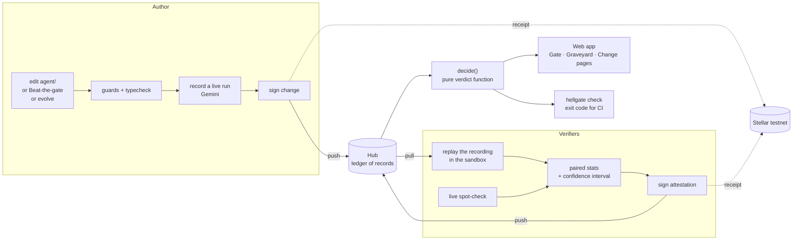
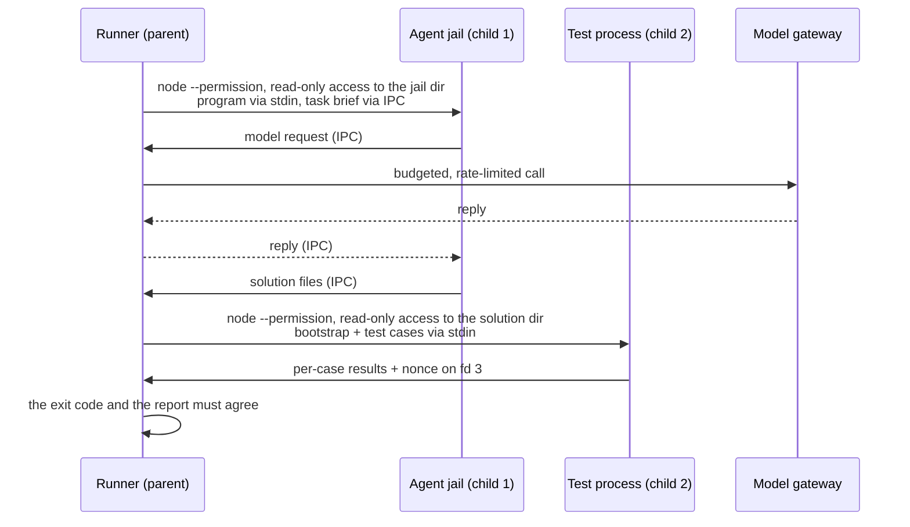
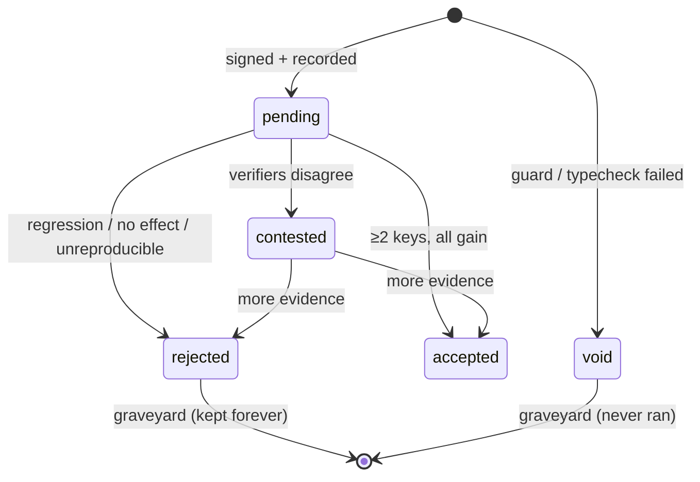
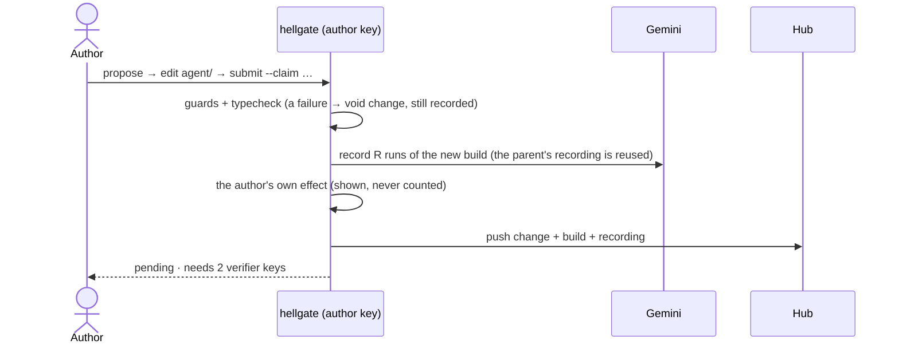
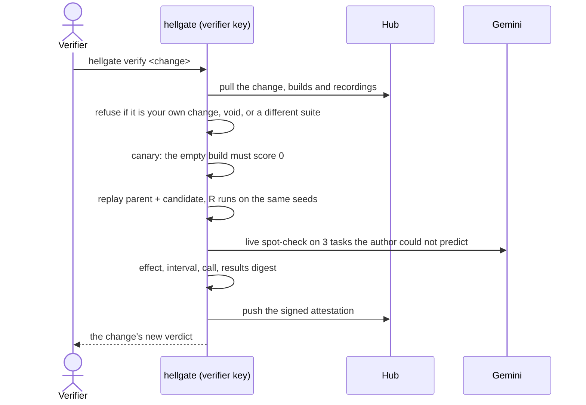

# Hellgate architecture

> Every change to an AI agent must pass the gate. Changes that fail go to the graveyard,
> with the numbers that killed them, so nobody makes them again.

This document is the **design**: how Hellgate is built and why. The journey of a change,
step by step, is in [PIPELINE.md](PIPELINE.md). The exact bytes, records and formulas are
in [PROTOCOL.md](PROTOCOL.md). What is built so far, stage by
stage, is tracked in [STAGES.md](STAGES.md). The web app brief is in
[FRONTEND.md](FRONTEND.md).

---

## 1. The problem

People change an AI agent (its instructions, its retry logic, how it reads the model's
reply, which settings it uses), try a few examples, decide it "feels better", and ship
it. That causes three problems:

1. **No measurement.** There is no baseline, no repeat count and no idea of noise. A
   lucky run looks like progress.
2. **No trust.** Even when the author runs an evaluation, everyone else has to take the
   author's word for it. Nobody re-ran it.
3. **No memory.** Failed ideas live in one person's terminal history. The next person
   tries them again and pays for the same tokens.

Evaluation tools already measure. What is missing is a way to make a result
**believable to someone who was not in the room**. Hellgate fills that gap.

## 2. The idea in one paragraph

A **change** is a small edit to an agent plus a written **claim**: "this will raise the
score by at least 3 points, and it is false if…". The author records a real run of the
new version. Then at least two **verifiers**, holding keys other than the author's,
re-measure the old and the new version side by side on the same seeds. Each verifier
signs an **attestation** with the measured effect and a confidence interval. A pure
function turns the signed evidence into a **verdict**.

Accepted changes pass **through the gate** and become the new baseline. Everything else
goes to the **graveyard** with its epitaph: the claim, the measured effect and how it
died. Nothing is ever deleted. Each signature can also get a public, timestamped
**receipt** on the Stellar network.

## 3. Design principles

| # | Principle | What it means in the code |
|---|---|---|
| P1 | The author never judges their own change | Author attestations are ignored. Acceptance needs ≥ 2 distinct verifier keys. |
| P2 | Measure against noise, not against zero | A paired comparison with a bootstrap confidence interval. A gain must clear both the interval and a minimum effect. |
| P3 | Deterministic scoring | Unit tests decide pass or fail. No model grades another model. |
| P4 | Failure is data | Rejected, broken and never-ran changes are records, shown with their reason. Nothing is deleted. |
| P5 | Status is derived, never stored | The verdict is recomputed from the signed evidence on every read, so a cache cannot disagree with the evidence. |
| P6 | Evidence checks itself | Every record is content-addressed and signed. Any copy, from any source, can be checked offline. |
| P7 | Honest wording | The system says "distinct keys", never "distinct people". Every known limit is listed (§15). |
| P8 | Works without an API key | Replaying recorded runs needs no key and no network. Only recording and live checks call a model. |

## 4. Vocabulary

| Term | Meaning |
|---|---|
| **Agent** | The code around the model that we improve: instructions, loop, reply parsing and settings. It lives in `agent/`. |
| **Build** | An immutable snapshot of the agent's files. Its id is the hash of its contents. |
| **Suite** | The benchmark: coding tasks, each with test cases. Its id is the hash of every task file. |
| **Change** | A signed proposal: the parent change, the new build, a claim and a recording. It is one node of the tree. |
| **Claim** | The hypothesis, what would falsify it, the area it touches and the predicted effect. |
| **Recording** | The model's real responses, captured while the author ran the build, keyed by a hash of each request. |
| **Attestation** | A verifier's signed, paired measurement of parent against change, with a confidence interval. |
| **Verdict** | The derived status of a change: `pending`, `accepted`, `rejected`, `contested` or `void`. |
| **Gate path** | The chain of accepted changes from the first version to the current best. |
| **Graveyard** | Every `rejected` and `void` change, each with its epitaph. |
| **Ledger** | The set of all records. It is a set, not a chain, so merging two copies is a union. |
| **Hub** | The engine's HTTP server. It stores and serves records, runs demo jobs and feeds the web app. |
| **Digest** | A one-page summary of the gate path and the graveyard, read by people and by the proposer model. |
| **Receipt** | A Stellar transaction from the signer's own account whose memo is a record id. |
| **bp** | Basis points. 100 bp = 1 percentage point. Every score is an integer in bp. |

## 5. System overview



### 5.1 Repository layout (monorepo)

```
hellgate/
  engine/        TypeScript engine: CLI, hub server, every rule       (Node ≥ 22.18)
    src/
      core/      canonical JSON, sha256, ids, errors
      identity/  ed25519 keys in Stellar format, signing
      ledger/    record schemas, file store, hub client
      suite/     task loading, suite ids
      sandbox/   agent jail, test runner, result channel
      model/     gateway, Gemini client, record, replay, rate limit, budget
      measure/   runs, per-case scoring, pairing, bootstrap, results digest
      verdict/   decide(): the pure verdict function
      propose/   guards, typecheck, digest, evolve, challenge
      hub/       HTTP server: records, export, jobs, live events
      stellar/   funding, receipts                                  (later stage)
      cli/       commands and output
  web/           Next.js web app. A client of the hub; it never computes a verdict.
  agent/         the first version of the agent under test (the genesis build)
  suites/
    public/      the tasks everyone sees
  .hellgate/     the ledger: config.json and records/ (records are immutable, safe to commit)
  docs/          design, protocol, stages, frontend brief, shared log
```

Keys never live in the repository (§6.2).

### 5.2 Who runs what

| Part | Runs on | Talks to |
|---|---|---|
| CLI (`hellgate …`) | any machine with Node | the local `.hellgate/`, the hub, Gemini, Stellar |
| Hub (`hellgate serve`) | the demo machine | the local `.hellgate/`, Gemini (for jobs), the web app |
| Web app (`web/`) | the browser, served by Next.js | the hub only, over HTTP |
| A remote verifier | a second laptop | the hub: `pull`, then `verify`, then `push` |

## 6. Engine modules

Imports only point downward: `core` ← `identity` ← `ledger` ← … ← `cli`. `verdict/`
imports only *types* from `ledger/`, so the decision runs identically in the CLI, the
hub, tests and CI.

### 6.1 `core/`: one encoder, one hash
- **Canonical JSON:** UTF-8, keys sorted by code point, no whitespace, **integers only**
  (no floats, no `NaN`, no `-0`), and no `undefined`. A value it cannot encode throws.
  Scores are therefore stored as integer basis points.
- **Ids:** `sha256(canonical(body))`, as 64 lowercase hex characters.
- There is exactly one encoder and one hash helper in the codebase.

### 6.2 `identity/`: a key is an identity, and an identity is a Stellar account
- An identity is an ed25519 keypair. Its public name is a Stellar address (`G…`) and its
  secret is stored as a Stellar seed (`S…`). The same key signs Hellgate records and,
  later, Stellar transactions.
- Keys live outside the repo, in `~/.hellgate/identity.json` with mode 0600.
  `HELLGATE_HOME` points elsewhere (how one machine plays several verifiers), and
  `HELLGATE_SECRET` supplies a key directly (for CI and the hub's demo bots).
- Signatures are domain-separated: `hellgate/v1/<record type>\n` + canonical body. A
  signature over a change can never pass as a signature over an attestation.

### 6.3 `ledger/`: a set of self-checking records
- Records are immutable JSON files at `.hellgate/records/<first two hex>/<id>.json`.
- On read, each one is checked in order: its schema, that its file name is the hash of
  its body, then its signature. A record that fails is reported and ignored, never
  trusted.
- **It is a set, not a chain.** Machines that add records never conflict: syncing is a
  union of files, over the hub (`push`/`pull`) or over git.
- Order never decides a verdict. Where "the first one wins" would need an order, the
  rules use content instead (equivocation, PROTOCOL §9).

### 6.4 `suite/`: tasks the agent can read, tests it cannot

| File in `suites/public/<task>/` | Seen by the agent? | Purpose |
|---|---|---|
| `task.json` | yes, except internals | Entry file name, API (name and exact signature), constraints, timeout |
| `brief.md` | yes | The problem statement |
| `starter/` | yes | Optional read-only context |
| `cases.mjs` | **never** | The test cases. Each one is scored separately. |

- The suite id hashes every file, tests included. Editing one assertion makes a new
  suite, and old evidence stops counting.
- Tasks are designed to leave the baseline agent plenty of headroom: exact signatures,
  input validation, edge cases and output format. A baseline that already scores 95%
  cannot show a gain. The target is **30–55%** for the genesis build.

### 6.5 `sandbox/`: two processes, two walls



**Wall 1: the agent never sees the tests.**
- The jail is a fresh directory holding only the agent files and the task brief. The
  test cases are never in it.
- The agent process may only read the jail. It has no write access, no network (checked
  on Node 26), no child processes and no worker threads.
- The only way to the model is the IPC channel, served by the parent, which owns the
  budget.
- The IPC `send` function is captured and removed before the agent's code loads, so the
  agent cannot forge a reply or a result.

**Wall 2: the solution never reads the tests from disk.**
- The solution is written to a fresh directory. The test cases travel over stdin inside
  a bootstrap program and never touch disk.
- The bootstrap captures `assert`, its result writer and the JSON encoder before it
  imports the solution.
- It runs each case with a timeout and reports per-case results, tagged with a fresh
  nonce, on file descriptor 3.
- If the exit code and the report disagree, the task is `tampered`: it scores 0 and
  the batch is marked unclean.

**Determinism:** the agent gets a seeded `random()`, `Date` is frozen, and tasks start in
a seeded order. With the same model replies, the same build sends the same requests and
writes the same files. Replay depends on this.

Task concurrency defaults to 2 lanes, because the reference machine is a 2-core laptop.
`HELLGATE_LANES` raises it.

### 6.6 `model/`: one gateway, three modes

The agent only ever calls `kit.model.generate(request)`. The parent decides what answers:

| Mode | Answered by | Used for |
|---|---|---|
| `record` | Gemini, with every request and reply captured | the author's run of a new build |
| `replay` | the recording, matched by request hash | verifiers. No key, no network. A request missing from the recording is an error. |
| `live` | Gemini | spot-checks, Beat-the-gate, full live verification |

- **Request key:** `sha256(canonical({model, system, messages, maxOutputTokens,
  temperature, stop, seed}))`. Replay answers only the identical request, so a replay
  also proves the build sends exactly the requests that were recorded.
- **Gemini mapping:**
  - `system` → `systemInstruction`;
  - role `assistant` → `model`;
  - `maxOutputTokens`, `temperature`, `stopSequences` and `seed` pass through;
  - thinking budget is 0;
  - usage metadata → token counts;
  - `MAX_TOKENS` → `length`.
- **Seeds:** run *i* uses a seed derived from the suite id and *i*. It is sent to the
  model and also fixes the task order. Both sides of a comparison use the same seeds.
  Seeds do not depend on the change, so a build's recording is reused by every child.
- **Failures:** a token-bucket limiter (`HELLGATE_RPM`) and retries with backoff on HTTP
  429 and 5xx. An infrastructure failure is **never** scored as 0: the run is repeated,
  and if it keeps failing, nothing is signed.
- **Budget per task:** 6 calls, 60k tokens and 90 s, enforced in the parent.
- **Models:** the agent under test uses `gemini-3.1-flash-lite`. It is cheap, and a
  small model is where agent quality matters most; a burst of 12 parallel calls on the
  free tier returned 12 successes at about 1.5 s each. The proposer uses
  `gemini-3.5-flash`. Both are configuration.

### 6.7 `measure/`: from test cases to a confidence interval
1. **Task score per run** = passed cases ÷ total cases, in bp. Ten cases give ten
   observations instead of one pass/fail.
2. **Task mean** = the mean of that task's score over *R* runs (default 5) on the shared
   seeds.
3. **Per-task difference** `d_t` = the candidate's mean minus the parent's mean.
4. **Effect** = the mean of `d_t` over all tasks.
5. **95% interval** = a paired bootstrap that resamples tasks 2,000 times, using a
   deterministic sampler. Two verifiers with the same data get the same interval, to
   the bp.
6. **Call:**
   - `gain` if the interval's low end is above 0 **and** the effect is at least +300 bp;
   - `loss` if the interval's high end is below 0 **and** the effect is at most −300 bp;
   - `noise` otherwise.
7. **Results digest:** a hash of every per-case outcome of every run on both sides. In
   replay it is fully deterministic, so honest verifiers produce identical digests.

### 6.8 `verdict/`: one pure function
`decide(change, attestations, policy)` performs no I/O and reads no clock. The CLI, the
hub, the export and CI all call it. The full rule is in PROTOCOL §9:

```
guard or typecheck failed                  → void
(self, mismatched, even-run and equivocating attestations are dropped first)
a counted batch was tampered with          → rejected    NOT_CLEAN
replay digests disagree between verifiers  → contested   RESULTS_MISMATCH  (someone did not run it)
verifiers agree, but not with the author   → rejected    UNREPRODUCIBLE
2+ live spot-checks fail                   → rejected    UNREPRODUCIBLE
exactly 1 live spot-check fails            → contested   SPOT_CHECK_FAILED
fewer than 2 counted verifier keys         → pending     NEEDS_VERIFIERS
gain and loss both reported                → contested   CONFLICT
verifier effects too far apart             → pending     VERIFIERS_DISAGREE
all gain                                   → accepted    GAIN
all loss                                   → rejected    REGRESSION
otherwise                                  → rejected    NO_EFFECT
```



### 6.9 `propose/`: how changes are made
All three entry points go through the **same function** once the proposal exists:

| Entry | Who | What happens |
|---|---|---|
| `hellgate propose` + `submit` | a person | Copy the parent build to a workspace, edit it, submit it with a claim |
| **Beat the gate** (web) | anyone, e.g. a judge | Type one instruction. It is appended, as a quoted string, to the agent's instruction list, and the claim is filled from a template. |
| `hellgate evolve` | the proposer model | Read the digest and propose one change as JSON (claim + full file contents), with one repair turn |

**Guards** run before any model call:
- at most 2 files and 120 changed lines, all under `agent/`;
- `agent/contract.ts` is frozen, and the `solve` signature must be exact;
- imports must be relative siblings only;
- the claim must be falsifiable;
- **graveyard rules:** a motif that died twice needs an explicit `contradicts`, and an
  area with three deaths and no win needs a `whyThisTime`.

A TypeScript check then runs on a scratch copy. If a guard or the typecheck fails, the
change is still signed and stored as `void`, with the verbatim reason.

### 6.10 `hub/`: the backend of the web app

| Route | Purpose |
|---|---|
| `GET /v1/export` | The whole tree as one `hellgate/export/1` document (cached until the ledger changes) |
| `GET /v1/version` | A cheap fingerprint of the ledger, for live refresh |
| `GET /v1/records?after=` · `GET /v1/records/:id` · `POST /v1/records` | Record sync. Every posted record is fully validated. |
| `POST /v1/jobs` | Start a job: `verify` (as a demo bot key) or `challenge` (Beat the gate). Requires the hub token. |
| `GET /v1/jobs/:id/events` | Server-sent events: progress per task and run, then the final verdict |

- Records authenticate themselves, so record sync needs no login.
- Jobs spend model calls, so they need `HELLGATE_HUB_TOKEN`, which only the web server
  holds, and they run one at a time.
- The hub is a convenience, not an authority: anyone can pull every record and recompute
  every verdict offline.

### 6.11 `stellar/`: public receipts (later stage)
- Testnet accounts are funded by Friendbot.
- A receipt is one transaction from the signer's own account, with a no-op
  `bump_sequence` operation and `memo_hash = record id`.
- **Anyone can check it:** fetch the transaction from Horizon and compare the memo and
  the source account with the record. The Stellar transaction is signed by the same
  ed25519 key as the record, so the receipt binds that record to that account at a
  public time.
- **What it proves:** the record existed by then, the holder of that key published it,
  and later edits are detectable.
- **What it does not prove:** that the work was done, or that two accounts are two
  people.

## 7. End-to-end flows

### 7.1 Submitting a change



### 7.2 Verifying a change



### 7.3 Beat the gate (live, from the web app)
1. A visitor types one instruction, for example "Validate every argument and throw a
   TypeError on bad input."
2. The hub builds the change: the current best build with that line appended to the
   instruction list. The guards run as usual.
3. It records a live run, streaming progress to the page.
4. Two demo bot keys on the hub verify it in turn, streaming progress again.
5. The verdict appears: through the gate, or into the graveyard with its numbers. The
   change is stored like any other, so it stays in the tree.

### 7.4 The improvement loop
1. `evolve` reads the digest.
2. It proposes one change, avoiding dead motifs unless it argues against them.
3. It records and submits; verifiers attest; the verdict feeds the next digest.

The web app plots the score along the gate path, generation by generation.

### 7.5 The pull-request gate (later stage)
1. A contributor commits `.hellgate/records/` with the PR.
2. CI verifies with its own key (`HELLGATE_SECRET`); a maintainer verifies with another.
3. `hellgate check` exits 0 (accepted), 1 (rejected, void or contested) or 2 (pending).
4. A bot comments the verdict.

## 8. The demo scenarios
These are built into the plan (STAGES.md). Each one must produce its verdict for real.

| Scenario | What happens | Expected verdict |
|---|---|---|
| **Real fix** | Give the model the exact function signatures and one worked example | `accepted` GAIN |
| **The "feels better" trap** | A reword that looked better in one run | `rejected` NO_EFFECT |
| **Regression** | Remove the reply-format rule | `rejected` REGRESSION |
| **Cheating agent** | An agent that tries to read the tests | `void` (blocked by the guard). If the guard is bypassed, the jail denies the read and the task scores 0. |
| **Lazy verifier** | A key signs copied numbers without running anything | `contested` RESULTS_MISMATCH |
| **Beat the gate** | A judge's one-line instruction, measured live | whatever the evidence says |

## 9. Cost model
The defaults are R = 5 runs, 16 tasks, 3 spot-check tasks, and the baseline agent's one
call per task.

| Action | Model calls |
|---|---|
| Record a new build | 5 × 16 = **80** (the parent's recording is reused) |
| Verify (replay + spot-check) | **3** |
| Full live verify | 2 × 5 × 16 = **160** |
| Beat the gate | **80** to record, plus **6** for two verifiers' spot-checks |

## 10. Configuration
`.hellgate/config.json` pins the tree:

| Key | Default | Meaning |
|---|---|---|
| `tree` | set at `init` | the tree name, which every record names |
| `suite` | set at `init` | the public suite id |
| `model.agent` | `gemini-3.1-flash-lite` | the model under the agent |
| `model.proposer` | `gemini-3.5-flash` | the model behind `evolve` |
| `policy.minVerifiers` | 2 | distinct non-author keys needed |
| `policy.runs` | 5 | runs per side; odd and at least 3 |
| `policy.minEffectBp` | 300 | the minimum effect, on top of the interval |
| `policy.bootstrap` | 2000 | bootstrap resamples (95% two-sided interval) |
| `policy.maxVerifierSpanBp` | 600 | above this spread of verifier effects, another verifier is needed |
| `policy.spotCheckTasks` | 3 | live tasks re-run by each verifier |
| `policy.spotCheckToleranceBp` | 2500 | how much better a recording may look than live reality |
| `policy.allowedVerifiers` | `[]` | an optional allow-list; empty means open |

Environment variables: `GEMINI_API_KEY`, `HELLGATE_HOME`, `HELLGATE_SECRET`,
`HELLGATE_HUB`, `HELLGATE_HUB_TOKEN`, `HELLGATE_RPM`, `HELLGATE_LANES`.

## 11. CLI

| Command | What it does |
|---|---|
| `hellgate init` | Create the tree, pin the suite, add the genesis change from `agent/` |
| `hellgate id create \| show` | Your key and Stellar address |
| `hellgate propose [--parent]` | A workspace with the parent build, ready to edit |
| `hellgate submit --claim … --falsified-if … --area … --predict …` | Guards, typecheck, record, sign, push |
| `hellgate verify <change>` | Paired measurement, then sign and push an attestation |
| `hellgate status [<change>] [--why]` | Verdict, code, reason, and what was ignored |
| `hellgate check <change>` | CI form: exit 0 / 1 / 2, `--json` |
| `hellgate tree` · `graveyard` · `show <change>` · `digest` | Read the tree |
| `hellgate export` | The `hellgate/export/1` document |
| `hellgate serve` · `push` · `pull` | Hub and sync |
| `hellgate evolve [--dry-run]` | The proposer reads the digest and submits one change |

Exit codes: 0 ok · 1 rejected (`check`) · 2 pending (`check`) · 3 usage · 4 refused ·
5 integrity · 6 environment · 7 interrupted.

## 12. Web app
`web/` is a Next.js client of the hub. It renders `GET /v1/export`, starts jobs, and
streams their events. It never computes a verdict. The pages, components and user flows
are specified in [FRONTEND.md](FRONTEND.md).

## 13. Testing strategy
- **Unit tests** sit next to each module (`*.test.ts`, run with `node --test`).
- **Frozen vectors** pin canonical JSON, ids, seeds and the bootstrap, so a refactor
  cannot silently change a hash.
- **Sandbox canaries:**
  - an empty agent scores 0;
  - an agent that reads the tests is denied;
  - a solution that opens the tests gets `ENOENT`;
  - network access is denied;
  - a solution that forges a result is `tampered`.
- **Verdict table:** one test per row of PROTOCOL §9.
- **End-to-end:** a temporary tree with three keys runs propose → submit → verify ×2 →
  check offline, using a recorded fixture.
- **Live smoke:** one task against real Gemini, run on demand, never in CI.

## 14. Threat model

| Threat | Mitigation | Remaining risk |
|---|---|---|
| The author approves their own change | Author attestations are ignored, and `verify` refuses | none for distinct keys |
| The author cherry-picks good runs | The author's numbers never count. Verifiers measure both sides on fixed seeds. | none |
| The author fabricates a recording | Live spot-checks on tasks the author could not predict | fabrication inside the tolerance |
| A lazy verifier signs without running | Replay is deterministic, so digests must match the others' and the author's | two colluding copiers |
| A verifier signs conflicting attestations | All of that key's attestations for the change are dropped | none |
| The agent reads the tests | Tests are never in the jail; reads limited to the jail; no network | bugs in Node's permission model |
| The solution games the test runner | Primitives captured first, a nonce, and the exit code cross-checked | same-process tricks by adversarial generated code |
| The suite is quietly edited | The suite id hashes the tests and is pinned in every record | none |
| A record is tampered with | Content ids and signatures. Stellar receipts add public time. | records with no receipt |
| One person runs many keys | An optional allow-list. Account history is visible on Stellar. | **not solved**: distinct keys are not distinct people |
| The provider changes the model | The model id is in every record, recordings pin outputs, and spot-checks expose drift | drift inside the tolerance |
| A key is stolen | Kept outside the repo, mode 0600, never logged | machine compromise |
| A Beat-the-gate input abuses the hub | The input is length-limited and inserted as a quoted string; jobs need the hub token and run one at a time | quota exhaustion, mitigated by the rate limit |

## 15. What Hellgate does not prove
- **That two keys are two people.** It says "distinct keys" and means exactly that.
- **That a gain generalises beyond the suite.** Sixteen tasks are evidence, not proof.
- **That a live model is deterministic.** Seeds reduce variance, and the interval
  measures what remains.
- **That a receipt means the work was done.** A receipt proves existence, time and
  authorship. The results digest and the spot-checks test the work.

## 16. Key design decisions

| Decision | Why |
|---|---|
| A set-based ledger, not a chain | Verifiers on different machines never conflict. Order never decides anything. |
| Per-case scoring | Pass/fail per task wastes most of the signal from the same model calls. |
| A bootstrap over tasks | No distributional assumptions, honest about what generalises, and reproducible to the bp |
| Seeds from the suite, not the change | A build's recording is reused by every child, which halves the cost of each change |
| Record once, replay everywhere | A free-tier key is enough, verification is deterministic, and lazy verifiers are detectable |
| A minimum effect on top of the interval | A gain must be both real and big enough to matter |
| The Stellar key is the Hellgate key | One identity, checkable on any block explorer |
| Integer-only canonical JSON | Integers hash identically in every language. Floats do not. |
| The web app is a hub client | The verdict is computed in exactly one place, and the frontend can be built in parallel against a mock |
| Void changes are kept | "This did not even compile" is worth knowing before you try it again |

## 17. Later stages
In priority order, after the core and the demo scenarios work:
1. Stellar receipts.
2. Paying verifiers on a final verdict, including a multi-signature escrow that only two
   verifier keys can release.
3. A held-out sealed suite that only verifiers hold, which adds an `OVERFIT` verdict.
4. A GitHub Action.
5. An MCP tool, so agents can call `check`.
