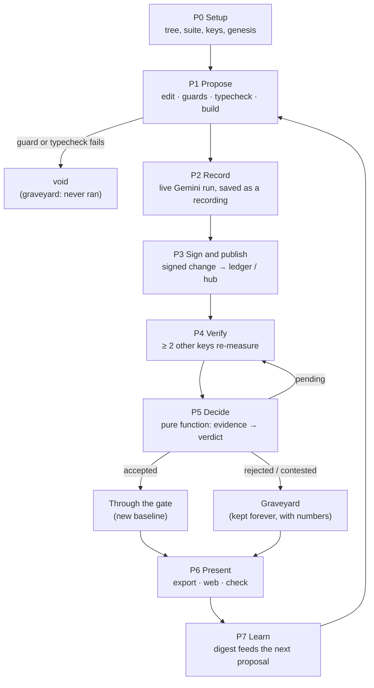
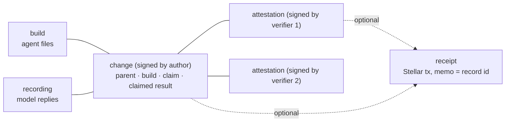

# The Hellgate pipeline

The whole journey of a change, from an idea to a verdict, step by step. This is the
**runtime** pipeline: what happens when someone uses Hellgate. The order we *build* it in is
[STAGES.md](STAGES.md). The reasoning is in [ARCHITECTURE.md](ARCHITECTURE.md), and the exact
bytes and formulas are in [PROTOCOL.md](PROTOCOL.md).

To avoid mixing the two: **pipeline steps** are P0–P7 here, and **build stages** are the
numbered stages in STAGES.md.

---

## 1. The pipeline at a glance

| Step | What happens | Who | Produces | Built in stage | Tier |
|---|---|---|---|---|---|
| **P0 Setup** | Create the tree, pin the suite, make keys, add the genesis change | anyone, once | `config.json`, genesis `change` | 1, 2, 7, 9 | 1 |
| **P1 Propose** | Edit the agent, run the guards and the typecheck, snapshot a build | author | `build` (or a `void` change) | 9 | 1 |
| **P2 Record** | Run the new build live on the suite, saving every model reply | author | `recording` | 5, 6, 7 | 1 |
| **P3 Sign and publish** | Assemble the change, sign it, store it, push it | author | signed `change` | 2, 9, 10 | 1 |
| **P4 Verify** | Re-measure old and new side by side, sign the result | ≥ 2 verifier keys | signed `attestation` each | 4, 5, 6, 9, 13 | 1 (spot-check: 2) |
| **P5 Decide** | Turn the evidence into a verdict | anyone, any machine | a verdict (derived, never stored) | 8 | 1 |
| **P6 Present** | Show the gate and the graveyard; gate CI | hub, web, CLI | export document, exit code | 9, 10, 12 | 1 |
| **P7 Learn** | Summarise what passed and what died for the next proposal | proposer | digest, next change | 15 | 3 |

Receipts on Stellar (P3 and P4) are an optional extra step, Tier 3 (Stage 16).

## 2. The records, and how they link

Everything the pipeline produces is an immutable, content-addressed record. Nothing is ever
edited or deleted.

| Record | Created in | Signed by | Refers to |
|---|---|---|---|
| `build` | P1 | no signature | nothing |
| `recording` | P2 | no signature | its build and the suite |
| `change` | P3 | the author | parent change, build, parent build, suite, recording |
| `attestation` | P4 | a verifier | the change, both builds, the suite |
| `receipt` | P3 / P4 | the Stellar transaction carries the signature | one record id |

The **verdict is never a record.** It is recomputed from the records every time anyone asks
(ARCHITECTURE P5), so a cache can never disagree with the evidence.

---

## 3. Step by step

### P0 Setup (once per tree)
**Input:** the `agent/` folder, the `suites/public/` tasks, a Gemini key.
1. `hellgate id create` makes your key. It lives outside the repo and its public name is a
   Stellar address.
2. `hellgate init` computes the **suite id** (a hash of every task file, tests included),
   writes `.hellgate/config.json` with the suite id, the models and the policy, and creates
   the **genesis change**: the first agent, with the empty build as its parent.
3. The genesis change is verified like any other, so even the baseline score is measured by
   other keys.

**Output:** a tree with one change, `pending`.

### P1 Propose
**Input:** a parent change (by default the best accepted one) and an idea.

Three ways in, all through the same code once the proposal exists:

| Way | Who | How |
|---|---|---|
| By hand | a person | `hellgate propose` copies the parent build into a workspace. Edit it. `hellgate submit --claim …`. |
| Beat the gate | anyone, for example a judge | Type one instruction in the web app. It is appended, as a quoted string, to the agent's `RULES` list. |
| Proposer model | `hellgate evolve` | The model reads the digest and returns one change as JSON. (Tier 3) |

**Every proposal must carry a claim:** the hypothesis (30–600 characters), what would falsify it,
the area it touches, a short motif name, and the predicted effect in basis points.

**Checks, in order. The first failure stops the change:**
1. **Guards:**
   - at most 2 files and 120 changed lines, all under `agent/`;
   - `agent/contract.ts` unchanged and the `solve` signature exact;
   - imports are relative siblings only (no `node:fs`, no `node:child_process`, no network);
   - the claim is falsifiable;
   - the graveyard rules: a motif that already died twice needs `contradicts`, and an area
     with three deaths and no win needs `whyThisTime`.
2. **Typecheck** on a scratch copy of the agent.
3. **Build snapshot:** all agent files are hashed into a `build` id.

**If a guard or the typecheck fails,** the change is still signed and stored as `void`, with the
exact tool output. It never runs, it costs nothing, and it appears in the graveyard as a lesson
("an agent that tried to read the tests", "code that did not compile").

**Output:** a `build`, or a `void` change.

### P2 Record
**Input:** the new build.
1. The build runs on the whole public suite, **5 runs**, in `record` mode. Every model request
   and reply is captured, keyed by a hash of the exact request.
2. Seeds depend on the suite, not the change, so the **parent's recording is reused**. Only the
   new build costs model calls.
3. Each run happens in the sandbox (section 4). Each task is scored per test case.
4. The author's own effect (**claimed**) and its results digest are computed. They are shown
   in the UI and compared during decide, but **never counted** as evidence.

**Output:** a `recording` and the claimed result. About 80 model calls for a new build.

### P3 Sign and publish
1. Assemble the `change`: tree, parent, build, parent build, suite, claim, origin
   (`human`, `agent` or `challenge`), the mechanical result, the recording and the claimed
   result.
2. Sign it with the author's key. The signature is domain-separated, so it cannot be replayed
   as any other kind of record.
3. Write the records to `.hellgate/records/` and `push` them to the hub. Syncing is a union of
   files, so machines never conflict.
4. (Tier 3) Post a Stellar receipt: a transaction from the author's account with the change id
   as its memo.

**Status now:** `pending`, "needs 2 verifier keys".

### P4 Verify (once per verifier key, at least two keys)
Anyone with a key other than the author's can do this: `hellgate verify <change>`, a button in
the web app, or a CI job.

1. **Pull** the change, the builds and the recordings. **Validate** every record: schema, then
   that its id is the hash of its body, then its signature.
2. **Refuse** if you are the author (exit code 4), if the change is `void`, or if it belongs to
   a different suite.
3. **Canary:** the empty build must score 0 on every case. If it doesn't, the sandbox is
   broken and nothing is signed.
4. **Replay** the parent and the candidate on the same 5 seeds. The model is not called: the
   recording answers, but only for the **identical request**. A request the recording does not
   hold fails the replay.
5. **Measure** (details in section 5): per-case scores, a mean per task, the difference per
   task, the effect, a 95% interval, a call (`gain`, `loss` or `noise`), and a **results
   digest**: a hash of every per-case outcome.
6. **Spot-check (Tier 2):** 3 tasks, picked from a hash of the verifier's key and the change id
   so the author can't predict them, are run **live** against Gemini. If the recording looks
   much better than live reality, the check fails.
7. **Sign** the attestation and push it. (Tier 3: post a receipt.)

**Output:** an `attestation`. About a minute of compute in replay, plus 3 model calls for the
spot-check.

**Why this resists faking:**
- A lazy verifier who signs copied numbers produces a different results digest, so the change
  becomes `contested`.
- A fake recording is caught by the live spot-check.

### P5 Decide
`decide(change, attestations, policy)` is a **pure function**: no files, no network, no clock.
The CLI, hub, export and CI all call the same one. Steps run in order and the first match wins
(full detail in PROTOCOL §9):

| # | Rule | Result |
|---|---|---|
| 1 | The change never ran (guard, typecheck or crash) | `void` |
| 2 | Drop attestations that are the author's own, mismatched, even-run, or from a key not on the allow-list | (ignored, with a reason) |
| 3 | A key that signed conflicting attestations loses all its votes on this change | (flagged `equivocation`) |
| 4 | A counted batch was tampered with | `rejected` NOT_CLEAN |
| 5 | Verifiers' results digests disagree | `contested` RESULTS_MISMATCH |
| 6 | Verifiers agree with each other but not with the author's claim | `rejected` UNREPRODUCIBLE |
| 7 | Two or more live spot-checks failed | `rejected` UNREPRODUCIBLE |
| 8 | Exactly one spot-check failed | `contested` SPOT_CHECK_FAILED |
| 9 | Fewer than 2 distinct counted keys | `pending` NEEDS_VERIFIERS |
| 10 | One verifier says gain and another says loss | `contested` CONFLICT |
| 11 | The verifiers' effects are too far apart | `pending` VERIFIERS_DISAGREE |
| 12 | **Every** counted verifier reports a gain | `accepted` GAIN |
| 13 | Every counted verifier reports a loss | `rejected` REGRESSION |
| 14 | Anything else (the interval includes zero, or the gain is under 3 points) | `rejected` NO_EFFECT |

Rule 12 is deliberately strict: **all** counted verifiers must agree, not a majority.

More attestations can change a verdict later, because it is recomputed from all the evidence.
A `void` change can never change: it never ran.

### P6 Present
- **Accepted** → **through the gate.** It becomes the default parent for the next change, and the
  gate path extends.
- **Rejected, contested and void** → the **graveyard**: the claim, how it died, the effect and
  interval, and "claimed X, measured Y".
- `hellgate export` (or the hub's `GET /v1/export`) writes one document with everything the
  web app shows (PROTOCOL §11). The web app **never computes a verdict itself.**
- `hellgate check <change>` is the CI form: exit **0** accepted, **1** rejected, void or
  contested, **2** pending.
- Live progress of verification and Beat the gate streams to the web app as events
  (PROTOCOL §10.1).

### P7 Learn (Tier 3)
`hellgate digest` writes a one-page summary: the gate path, every graveyard epitaph, which
areas have been tried, and which have not. A person reads it. The proposer model reads it, and
the guards enforce what it says: a dead idea can't be retried without an argument. Then P1
starts again from the new best build.

---

## 4. The sandbox (used in P2, P4 and the spot-check)

Two processes, two walls. The agent must never see the tests.

1. **Agent jail.** The agent runs in its own Node process that can read only its own folder: the
   agent files and the task description. No tests, no network, no other programs. The only
   route to the model is a message channel served by the parent process, which owns the budget
   (6 calls, 60k tokens, 90 s per task).
2. **Test process.** The solution the agent wrote runs in a second process. The tests are sent
   in memory and never written to disk. Each case reports its result along with a one-time
   random code, and the parent also checks the exit code. If the two disagree, the task is
   marked `tampered` and scores 0.

Randomness is seeded and the clock is frozen, so given the same model replies, the same build
produces the same requests and the same files. That is what makes replay work.

## 5. The measurement, in one place

1. **Per case:** each task has about 10 test cases. A run's score for a task = cases passed ÷
   cases, in basis points (100 bp = 1 point).
2. **Per task:** the mean over the 5 runs.
3. **Difference per task:** candidate mean minus parent mean.
4. **Effect:** the mean of the differences across tasks.
5. **Interval:** resample the tasks 2,000 times with a deterministic generator, compute the
   effect each time, and take the middle 95%. The same data always gives the same interval.
6. **Call:**
   - `gain`: the whole interval is above 0 **and** the effect is at least +3 points.
   - `loss`: the whole interval is below 0 and the effect is at most −3 points.
   - `noise`: otherwise.

## 6. What can go wrong, and where it ends up

| Event | Step | Outcome |
|---|---|---|
| The change breaks a rule or does not compile | P1 | `void`, kept in the graveyard with the exact reason |
| An agent tries to read the tests | P1 (guard), or P2/P4 (the jail) | `void`, or the read is denied and the task scores 0 |
| An infrastructure failure (rate limit, network) | P2, P4 | The run is repeated. It is never scored as 0. If it keeps failing, nothing is signed. |
| The author tries to verify their own change | P4 | Refused. Nothing is signed. |
| A replay asks for a request the recording lacks | P4 | The batch is unclean → `rejected` NOT_CLEAN |
| A verifier signs without running anything | P5 | Digest mismatch → `contested` RESULTS_MISMATCH |
| The author fabricated the recording | P4 / P5 | Live spot-check fails → `contested`, then `rejected` UNREPRODUCIBLE |
| Verifiers disagree on direction | P5 | `contested` CONFLICT |
| Only one verifier has attested | P5 | `pending` |
| Gain is real but under 3 points, or inside the noise | P5 | `rejected` NO_EFFECT, kept so nobody retries it |

## 7. Who does what

| Actor | Can | Cannot |
|---|---|---|
| **Author** | Propose, record, sign, publish | Count their own measurement, or verify their own change |
| **Verifier** | Re-measure, sign an attestation | Verify a change they authored. Two attestations from one key count as one. |
| **Hub** | Store and serve records, run demo jobs, stream progress | Decide anything the pure function wouldn't |
| **Web app** | Show everything, start jobs | Compute a verdict |
| **Proposer model** | Propose changes from the digest | Skip the guards or the verification |

## 8. Timing and cost (targets)

| Action | Model calls | Time |
|---|---|---|
| Record a new build (P2) | about 80 | about 1 minute (calls take about 1.5 s on the small model) |
| Verify in replay (P4) | 3 (spot-check only) | about a minute, mostly the sandbox on a 2-core laptop |
| Beat the gate, end to end | about 86 | about 3 minutes |
| A fully live verification | about 160 | a few minutes |

## 9. Example: the "feels better" trap

The numbers are illustrative.

1. **P1:** an author rewords the instructions to "sound more careful". They tried it by hand on
   three tasks and it looked better. The guards and the typecheck pass.
2. **P2:** the live run on 16 tasks gives the author a claimed effect of **+9.2 points**.
3. **P3:** the change is signed and pushed. Status: `pending`.
4. **P4:** two verifiers replay both builds on the same seeds. One measures −0.3 points with
   an interval of −3.6 to +4.0. The other measures −1.1, with an interval of −4.4 to +3.5.
5. **P5:** neither interval is above zero, so both calls are `noise`. Verdict: `rejected`
   NO_EFFECT.
6. **P6:** it goes to the graveyard, with "claimed +9.2, measured about 0". The author's single
   lucky run is shown beside the verified result.
7. **P7:** the digest now lists "careful wording" as tried and dead.

## 10. Where each step lives in the code

| Step | Module (ARCHITECTURE §6) | CLI command |
|---|---|---|
| P0 | `core/`, `identity/`, `ledger/`, `suite/` | `id create`, `init` |
| P1 | `propose/` | `propose`, `submit`, `evolve` |
| P2 | `sandbox/`, `model/`, `measure/` | `submit` |
| P3 | `ledger/`, `hub/` | `submit`, `push` |
| P4 | `sandbox/`, `model/`, `measure/` | `verify` |
| P5 | `verdict/` | `status`, `check` |
| P6 | `hub/`, `web/` | `export`, `check`, `serve` |
| P7 | `propose/` | `digest`, `evolve` |
